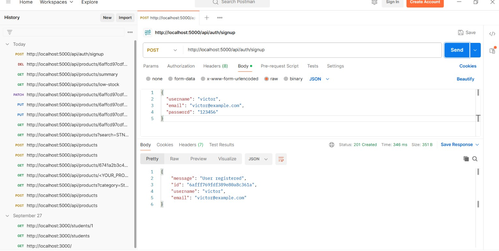
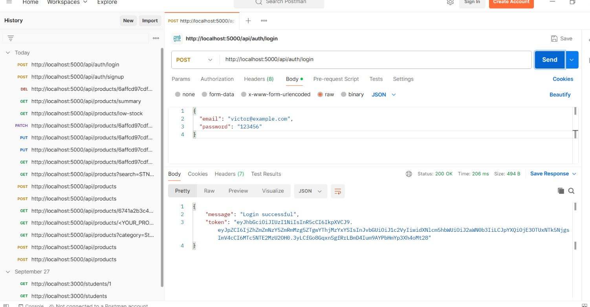
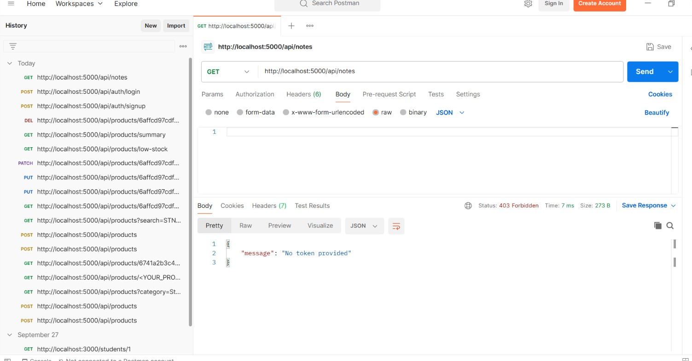
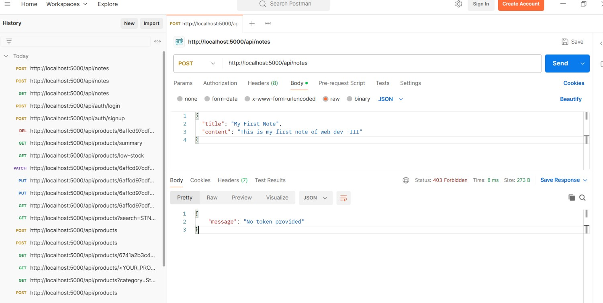
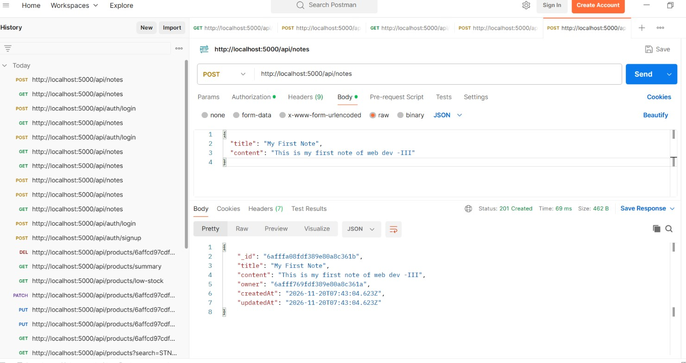
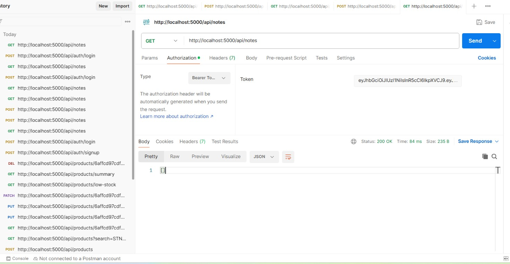
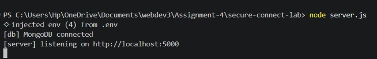

# Lab 4: Secure Connect and Communication Platform

**Course:** Web Dev III | **Unit:** Unit - 4 | **Marks:** 2.5

## Overview
A secure server-side backend application built with **Node.js**, **Express.js**, **MongoDB**, **JWT**, **bcrypt**, **Socket.IO**, and Node.js **EventEmitter**. It provides user registration and login, stateless JWT authentication, Role-Based Access Control (RBAC), protected CRUD operations for personal notes, and real-time room-based chat without relying on pre-built authentication or chat frameworks.

---

## Tech Stack
- **Node.js** & **Express.js** — Server runtime, REST routing, and middleware
- **MongoDB** & **Mongoose** — Persistent data storage for users and notes
- **bcrypt** — Password hashing and verification
- **jsonwebtoken (JWT)** — Stateless authentication and authorization tokens
- **Socket.IO** — Real-time, bidirectional room-based communication
- **Node.js `events` (`EventEmitter`)** — Event-driven logging and domain event handling
- **dotenv** — Environment variable management

---

## Project Structure
```text
secure-connect-lab/
├── config/
│   └── db.js
├── events/
│   └── appEvents.js
├── middleware/
│   └── authMiddleware.js
├── models/
│   ├── Note.js
│   └── User.js
├── routes/
│   ├── authRoutes.js
│   └── notesRoutes.js
├── .env
├── package.json
├── README.md
├── server.js
└── test-chat.js
```

## Output Screenshots

### 1. User Signup (`POST /api/auth/signup`)


### 2. User Login & JWT Generation (`POST /api/auth/login`)


### 3. Protected Route Blocked Without Token (`GET /api/notes` — 403 Forbidden)


### 4. Protected Route Blocked on Create Without Token (`POST /api/notes` — 403 Forbidden)


### 5. Create Note with Valid JWT (`POST /api/notes` — 201 Created)


### 6. Fetch Notes with Valid JWT (`GET /api/notes` — 200 OK)


### 7. Server Connection & Socket.IO Real-Time Chat Console

